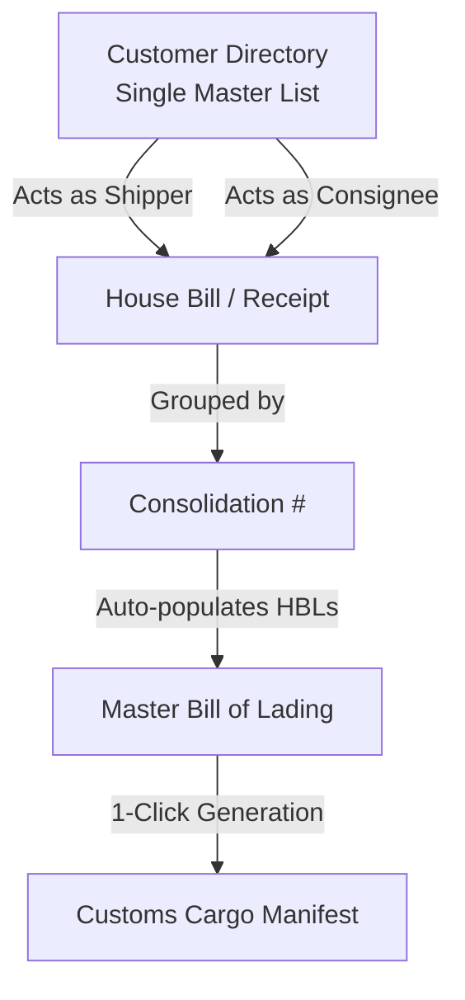

# AI Engineering Specification & Implementation Blueprint (`ai.md`)

> **Target:** Warehouse & Ocean Freight Management System  
> **Source Directive:** [client.md](file:///d:/Kiaan%20Work/oct/warehouse/warehouse/client.md) (Client Feedback by Kedreana)  
> **Role:** AI Agent Coding & Architecture Guide

---

## 1. System Context & Paradigm Shift

The previous architecture was mistakenly built for a **VOCC (Vessel Owning Common Carrier)** operating massive container fleets and scheduled liner services in the **Bahamas**. 

### The Correct Business Reality
* **Organization:** **NVOCC / Freight Forwarding Agent** (Non-Vessel Operating Common Carrier).
* **Operating Region:** **Eastern Caribbean** (small feeder vessels, inter-island routes). **Zero Bahamas operations**.
* **Asset Model:** They do **NOT** own vessels or container fleets. Containers are leased on-demand from VOCCs, stuffed with consolidated cargo, and exported.
* **Core Philosophy:** Minimalist, agent-focused, fast paperwork flow:
  $$\text{Warehouse Receipts} \longrightarrow \text{Consolidation #} \longrightarrow \text{House B/Ls} \longrightarrow \text{Master B/L} \xrightarrow{\text{1-Click}} \text{Cargo Manifest}$$

---

## 2. Core Architectural Changes

---

## 3. Detailed Component Specifications

### 3.1. Customer & Consignee Unification
* **Root Issue:** System previously enforced rigid classifications (`Commercial Importer`, `Shipper`, `Consignee`) and automatically overwrote customer profiles when an importer was selected.
* **Changes Required:**
  1. **Unified Customer Directory:** One directory table `customers`. Any contact entry can be selected as `Shipper`, `Consignee`, or `Notify Party` across all intake forms.
  2. **Remove Auto-Switch Bug:** In [CreateWarehouseReceipt.jsx](file:///d:/Kiaan%20Work/oct/warehouse/warehouse/frontend%20(2)/src/pages/warehouse/CreateWarehouseReceipt.jsx) and [CustomerModal.jsx](file:///d:/Kiaan%20Work/oct/warehouse/warehouse/frontend%20(2)/src/components/modals/CustomerModal.jsx), decouple the importer/consignee select from updating the parent customer account profile.
  3. **Remove Classifications:** Eliminate the `accountType` dropdown restrictions (`Commercial Importer (Consignee)`, `Wholesaler`, `Private Consignee`). Replace with simple optional business tags or remove entirely.

---

### 3.2. Elimination of Unwanted Modules & Simplification
* **Remove Container Fleet Management:**
  * Deprecate [ContainersList.jsx](file:///d:/Kiaan%20Work/oct/warehouse/warehouse/frontend%20(2)/src/pages/shipping/ContainersList.jsx) from navigation and routing.
  * In B/L and Manifest screens, keep simple text inputs for `containerNumber` and `sealNumber` (without needing an asset database lookup).
* **Simplify Vessels (Vessel / Fleet Directory Only):**
  * In [VesselsList.jsx](file:///d:/Kiaan%20Work/oct/warehouse/warehouse/frontend%20(2)/src/pages/shipping/VesselsList.jsx), remove:
    * "Schedule Voyage" modal and voyage management.
    * "Active Voyage & Route" tracking column.
    * "Live Operational Status" widgets.
  * Retain a clean, simple **Vessel Fleet Directory** allowing basic CRUD operations (Vessel Name, IMO/Registration, Carrier/Owner, Capacity/Length).
* **Purge Bahamas Defaults:**
  * Remove hardcoded `NAS` (Nassau Container Port) and `BSNAS` defaults across modals ([BillOfLadingModal.jsx](file:///d:/Kiaan%20Work/oct/warehouse/warehouse/frontend%20(2)/src/components/modals/BillOfLadingModal.jsx), [ManifestModal.jsx](file:///d:/Kiaan%20Work/oct/warehouse/warehouse/frontend%20(2)/src/components/modals/ManifestModal.jsx), [NewConsolidationWizard.jsx](file:///d:/Kiaan%20Work/oct/warehouse/warehouse/frontend%20(2)/src/pages/consolidation/NewConsolidationWizard.jsx)).
  * Switch default ports to Eastern Caribbean destinations (e.g., St. Lucia, Barbados, Antigua, Grenada, St. Vincent, Dominica, etc.).

---

### 3.3. Master B/L & Manifest Workflow (Consolidation Linking)
* **Consolidation Number Integration:**
  * When opening [BillOfLadingModal.jsx](file:///d:/Kiaan%20Work/oct/warehouse/warehouse/frontend%20(2)/src/components/modals/BillOfLadingModal.jsx) to create a Master B/L:
    * Provide a **Select Consolidation #** dropdown populated from existing active consolidations.
    * Once selected, auto-fetch and display checkboxes for all **House Bills of Lading (HBLs)** attached to that consolidation.
    * Auto-aggregate totals: Total Packages, Gross Weight, CBM, and Container/Seal numbers from the consolidated bills.
* **1-Click Manifest Creation:**
  * In [BillOfLadingDetail.jsx](file:///d:/Kiaan%20Work/oct/warehouse/warehouse/frontend%20(2)/src/pages/bills/BillOfLadingDetail.jsx) and [MasterBLViewer.jsx](file:///d:/Kiaan%20Work/oct/warehouse/warehouse/frontend%20(2)/src/components/documents/MasterBLViewer.jsx), add a primary action button:
    * `⚡ Generate Manifest (1-Click)`
    * Clicking this will auto-generate the Customs Cargo Manifest pre-filled with the Master B/L data and its linked House B/L line items without manual data re-entry.

---

### 3.4. Full-Page Standard Ocean Bill of Lading Document Layout
* **Root Issue:** [MasterBLViewer.jsx](file:///d:/Kiaan%20Work/oct/warehouse/warehouse/frontend%20(2)/src/components/documents/MasterBLViewer.jsx) and [HouseBLViewer.jsx](file:///d:/Kiaan%20Work/oct/warehouse/warehouse/frontend%20(2)/src/components/documents/HouseBLViewer.jsx) currently render constrained cards (`maxWidth: 900px`) that do not fill the page and do not look like standard maritime paperwork.
* **Changes Required:**
  * Redesign the print/preview template using a **100% full-width grid layout** (Standard BIMCO / Ocean B/L style):
    * Top grid: Shipper / Exporter, Booking #, B/L #, Export References.
    * Middle grid: Consignee, Notify Party, Pier/Terminal, Pre-carriage, Vessel & Voyage, Port of Loading, Port of Discharge.
    * Container & Cargo table: Container / Seal Numbers, Marks & Numbers, No. of Packages, Description of Goods, Gross Weight, Measurement (CFT/CBM).
    * Bottom grid: Freight charges, Carrier clauses, Signature / Date block.
  * In print CSS (`@media print`), ensure zero wasted page margins and exact fit on standard Letter / A4 paper.

---

### 3.5. Clean Database State / Reset Procedure
* **Action:**
  * Create a clean database reset script (e.g., `npm run db:reset-clean` or dedicated seed).
  * Wipe all mock Bahamas data, fake containers, and test shipments.
  * Leave tables ready and clean for the client to enter their actual vessels, customers, and run end-to-end tests.

---

## 4. Key Files to Modify

| Area | File Path | Scope of Change |
|---|---|---|
| **Receipt / Intake** | [CreateWarehouseReceipt.jsx](file:///d:/Kiaan%20Work/oct/warehouse/warehouse/frontend%20%282%29/src/pages/warehouse/CreateWarehouseReceipt.jsx) | Fix consignee/importer selection, stop auto-changing customer profile. |
| **Customers** | [CustomerModal.jsx](file:///d:/Kiaan%20Work/oct/warehouse/warehouse/frontend%20%282%29/src/components/modals/CustomerModal.jsx) | Remove rigid classification dropdowns; unify party role. |
| **Navigation** | [App.jsx](file:///d:/Kiaan%20Work/oct/warehouse/warehouse/frontend%20%282%29/src/App.jsx) / Navigation Sidebar | Remove Containers List; update Vessels page title and routing. |
| **Vessels** | [VesselsList.jsx](file:///d:/Kiaan%20Work/oct/warehouse/warehouse/frontend%20%282%29/src/pages/shipping/VesselsList.jsx) | Strip out active voyage scheduler and operational status; keep Fleet Directory only. |
| **Master B/L** | [BillOfLadingModal.jsx](file:///d:/Kiaan%20Work/oct/warehouse/warehouse/frontend%20%282%29/src/components/modals/BillOfLadingModal.jsx) | Add Consolidation # selector; auto-fetch HBLs and aggregate totals. |
| **Manifest** | [BillOfLadingDetail.jsx](file:///d:/Kiaan%20Work/oct/warehouse/warehouse/frontend%20%282%29/src/pages/bills/BillOfLadingDetail.jsx) | Add 1-Click Manifest creation trigger. |
| **B/L Document** | [MasterBLViewer.jsx](file:///d:/Kiaan%20Work/oct/warehouse/warehouse/frontend%20%282%29/src/components/documents/MasterBLViewer.jsx) | Full-page ocean shipping grid layout for print/PDF export. |
| **Database** | [backend/src/db/seed.ts](file:///d:/Kiaan%20Work/oct/warehouse/warehouse/backend/src/db/seed.ts) | Replace Bahamas seed data with clean Eastern Caribbean defaults or clean wipe. |

---

## 5. Execution Protocol for AI Agents

1. **Rule 1 - Never Over-Complicate:** Strictly respect that the client is an NVOCC agent, not an ocean carrier. Resist adding extra enterprise liner features.
2. **Rule 2 - Check Before Changing:** When updating customer linking or B/L creation, ensure mock storage in [AppDataContext.jsx](file:///d:/Kiaan%20Work/oct/warehouse/warehouse/frontend%20%282%29/src/context/AppDataContext.jsx) and backend routes stay synchronized.
3. **Rule 3 - Aesthetics & Document Accuracy:** The B/L document must look 100% authentic to international maritime standards and fill the printed page.
