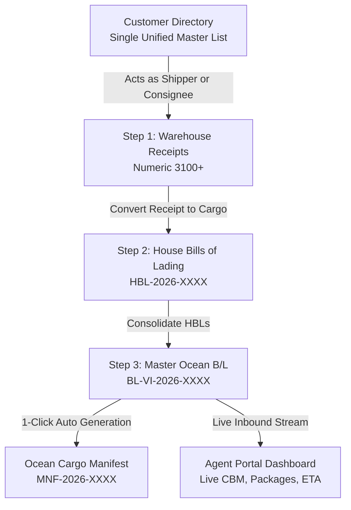

# AI Engineering Specification & Architecture Guide (`ai.md`)

> **Target:** Warehouse & Ocean Freight Management System  
> **Source Directive:** [client.md](file:///d:/Kiaan%20Work/oct/warehouse/warehouse/client.md) (Client Transcripts by Kedreana)  
> **Company:** VI Customs Brokers & Logistics  
> **Trade Lane:** Eastern Caribbean (Miami CFS ➔ Anguilla, Tortola, St. Kitts, St. Maarten, etc.)  

---

## 1. System Philosophy & Business Model

* **Business Identity:** **NVOCC / Freight Forwarding Agent** (Non-Vessel Operating Common Carrier).
* **Asset Model:** Does **NOT** own vessels or container fleets. Containers are leased on-demand from VOCCs (e.g., Tropical Shipping), packed with consolidated cargo, and exported.
* **Core Streamlined 3-Step Cargo Workflow:**
  $$\text{1. Warehouse Receipts (3100+)} \longrightarrow \text{2. House Bills of Lading} \longrightarrow \text{3. Master Bills of Lading \& Manifests}$$

---

## 2. User Roles & Access Governance (3 Core Roles)

The system is strictly aligned with the 3 operational roles:

| Role Key | Role Name | Default User | Operational Scope & Permissions |
| :--- | :--- | :--- | :--- |
| **`super_admin`** | Executive Administrator | Marcus Vance (`marcus.vance@vicustoms.com`) | Full administrative governance, system settings, user management, hold issuance & release, delete permissions. |
| **`warehouse`** | Warehouse Staff | Carlos Mendez (`carlos.m@vicustoms.com`) | Dock intake, create/view customers, weigh & measure cargo, issue Warehouse Receipts (starting 3100), print barcode labels, prepare House Bills of Lading. **Cannot delete records**. |
| **`agent`** | Destination Agent | Destination Agent Staff (`agent@vicustoms.com`) | Access assigned destination port Master Bills of Lading & Ocean Manifests, view inbound vessel consignments, track cargo volume/CBM. **Read-only access: Cannot edit, delete, or export manifests**. |

---

## 3. Data Flow & Calculations

### 3.1. Warehouse Receipts (Step 1)
* **Numbering:** Numeric sequence starting at `3100` (e.g., `WR-2026-3101`, `WR-2026-3102`).
* **Parties:** Single unified customer directory (`customers`). Any contact can be selected as Shipper or Consignee independently. Selecting an importer never mutates customer master data.
* **Dimensions & Volume:** Dimensions (L × W × H in inches) calculate CFT:
  $$\text{CFT} = \frac{L \times W \times H}{1728}, \quad \text{CBM} = \frac{\text{CFT}}{35.3147}$$

### 3.2. House Bills of Lading (Step 2)
* Converts received warehouse cargo into individual House B/Ls (`HBL-2026-0001`, `HBL-2026-0002`).
* Groups cargo items by destination port and consignee.

### 3.3. Master Bills of Lading & Manifests (Step 3)
* Groups multiple House Bills into a consolidated Master Ocean Bill of Lading (`BL-VI-2026-646`).
* Associates ocean carrier (e.g. *Tropical Shipping*), feeder vessel (e.g. *M/V Caribbean Carrier*), leased container (e.g. *MSKU-829104-5*), and seal number.
* **1-Click Manifest:** Generates outward customs manifest (`MNF-2026-0001`) with all consolidated line items, packages, gross weight, and volume.

### 3.4. Destination Agent Portal Integration
* **Live Feed:** [agentPortalService.js](file:///d:/Kiaan%20Work/oct/warehouse/warehouse/frontend%20(2)/src/services/agentPortalService.js) connects directly to PostgreSQL backend `/api/v1/bills-of-lading` and `/api/v1/manifests`.
* **Consignment Derivation:** If the legacy `shipments` table is empty, active Master Bills are automatically converted into inbound vessel consignments.
* **Volume Precision:** Total volume calculates from active Master B/Ls (`cbm` and `cft`). Decimal precision is preserved (e.g., `0.01 CBM (0.40 CFT)`) so small fractional consignments are never rounded down to zero.

---

## 4. Key Repository Files

| Layer | File Path | Description |
| :--- | :--- | :--- |
| **Backend DB** | [backend/src/db/schema/](file:///d:/Kiaan%20Work/oct/warehouse/warehouse/backend/src/db/schema/) | Drizzle ORM schemas for `warehouse_receipts`, `house_bills`, `bills_of_lading`, `manifests`, `customers`, `users`. |
| **Backend API** | [backend/src/modules/](file:///d:/Kiaan%20Work/oct/warehouse/warehouse/backend/src/modules/) | REST controllers & routes on Fastify (Port 5001). |
| **Frontend Auth** | [frontend (2)/src/context/AuthContext.jsx](file:///d:/Kiaan%20Work/oct/warehouse/warehouse/frontend%20%282%29/src/context/AuthContext.jsx) | Handles session, token, and dynamic permissions for the 3 core roles. |
| **Frontend Workflow** | [frontend (2)/src/pages/](file:///d:/Kiaan%20Work/oct/warehouse/warehouse/frontend%20%282%29/src/pages/) | Step 1 (`warehouse/`), Step 2 (`house-bills/`), Step 3 (`bills/` & `manifests/`). |
| **Agent Portal** | [frontend (2)/src/pages/agent-portal/](file:///d:/Kiaan%20Work/oct/warehouse/warehouse/frontend%20%282%29/src/pages/agent-portal/) | Agent Dashboard, assigned consignments, and live B/L inspection. |
